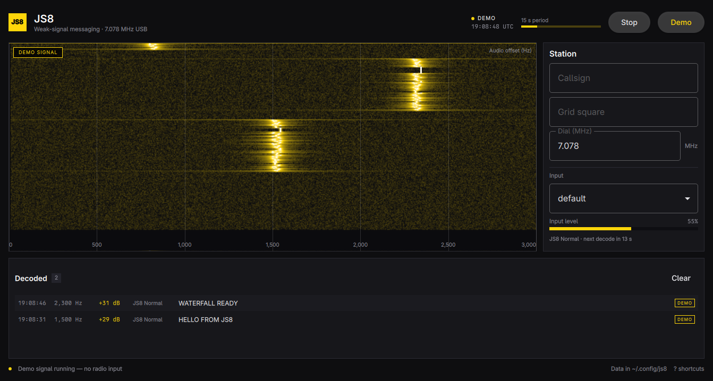

# JS8

A small JS8 receiver for Omarchy: audio from a radio interface, a live
waterfall drawn with raylib, and JS8 Normal decodes from
[gfsk8-modem](../gfsk8-modem). It is a Qt Quick app, so it follows the Omarchy
accent and window rounding live, and follows Omarchy's language.

This is a bootstrap, not a JS8Call replacement. It receives and decodes; it
does not transmit, key a radio, or implement CAT control. Normal (15 s) is the
only submode wired up so far.

## What it does

- Captures the default (or selected) audio input at 48 kHz and decimates it to
  the modem's 12 kHz, using the same FIR as gfsk8-modem's `js8rx` example.
- Draws a 0–3 kHz waterfall with a 4096-point FFT, about 44 seconds of history.
- Decodes JS8 Normal at each 15-second UTC boundary on a worker thread, so the
  waterfall keeps moving while the modem searches.
- Shows the decoded text, SNR, audio offset, and UTC time, and appends each
  decode to a log.
- Includes a synthesized demo signal so you can see the waterfall and decoder
  work without a radio. Everything it produces is labelled **DEMO**.
- Remembers the input device, callsign, grid, dial frequency, and whether the
  receiver was running.
- Rebuilds the waterfall palette and corners when the Omarchy theme changes,
  and swaps language files when the Omarchy language changes.

## Keyboard

| Key | Action |
| --- | --- |
| `Space` | Start or stop the receiver |
| `D` | Toggle the demo signal |
| `R` | Reload audio input devices |
| `?` | Show or hide the shortcut list |
| `Esc` | Close the shortcut list |
| `Q` | Quit |
| `Ctrl+Q` | Quit |

Single-key shortcuts are disabled while a text field has focus, so typing a
callsign or grid square cannot quit the app.

## Requirements

- Omarchy with `qmake6`, `make`, a C++ compiler, and Qt 6.
- `portaudio` (installed on Omarchy).
- A [gfsk8-modem](../gfsk8-modem) checkout beside this project (or set
  `GFSK8_MODEM_DIR`).
- raylib is fetched and built statically by `bin/build` (raylib 6.2). There is
  no raylib package dependency at runtime.
- Link-time X11 libraries: `libx11`, `libxrandr`, `libxinerama`, `libxcursor`,
  `libxi`. raylib's static archive includes its GLFW backend, which references
  them even though this app never calls `InitWindow`.

## Build and run

```sh
./bin/build
./build/js8 --demo
```

If the modem checkout is somewhere else:

```sh
GFSK8_MODEM_DIR=/path/to/gfsk8-modem ./bin/build
```

Run the tests (theme, language, settings, FFT, and a full modem
pack → modulate → decode round trip):

```sh
./bin/test
```

## Install

The Omarchy way, as a local package:

```sh
./bin/install
```

`bin/install` builds the package with `makepkg -fsi`, so it needs your sudo
approval.

If you would rather not install a package, `bin/install-user` puts the same
binary, desktop entry, and icon under your home directory, with no root:

```sh
./bin/install-user
```

Either way, JS8 appears in the Omarchy launcher (`Super + Space`).

## Data

| Path | Contents |
| --- | --- |
| `~/.config/js8/settings.json` | Callsign, grid, input device, dial frequency, last monitor state |
| `~/.local/share/js8/decodes.log` | One tab-separated line per decode |

Both are written atomically where it matters; the log is append-only. Demo
decodes are logged with the same format, so remove the log if you only want
real traffic.

## How it is put together

| File | Role |
| --- | --- |
| `src/main.cpp` | App setup, command line, screenshot harness |
| `src/backend.*` | State, timers, settings, spectrum rows, decode log |
| `src/audio.*` | PortAudio capture, 4:1 FIR decimator, 60 s ring, demo source |
| `src/decoderworker.*` | Worker thread that runs the gfsk8 decoder once per period |
| `src/spectrum.*` | 4096-point radix-2 FFT to 1024 bins over 0–3 kHz |
| `src/waterfallitem.*` | `QQuickFramebufferObject` rendered by raylib's rlgl |
| `src/Main.qml`, components | Layout, theme, shortcuts, help overlay |
| `src/theme.*`, `src/translator.*` | Live Omarchy accent/rounding and language |

### Why raylib lives inside Qt

raylib has no supported API for drawing into somebody else's window, so the
app does not try to run a second GLFW window beside Qt. `WaterfallItem` is a
`QQuickFramebufferObject`; its renderer calls raylib's own renderer (`rlgl`)
with Qt's current OpenGL context, uploads the waterfall as a texture, and
draws one textured quad. raylib still does the GL work, and Qt keeps the
window, theme, translations, and launcher integration.

The modem runs on its own `QThread` because a full 60-second search can take
long enough to stutter the waterfall on the GUI thread. `gfsk8::Decoder` is
not thread-safe, so there is exactly one instance and one decode thread.

## Demo signal

The demo is built with `gfsk8::pack()` + `gfsk8::modulate()` at 800, 1500, and
2300 Hz, mixed with a noise floor. It starts at each 15-second period and is
decoded by the real decoder, so it exercises the same path as a radio signal.
It never pretends to be a received station: the waterfall carries a
`DEMO SIGNAL` badge and every message has a `DEMO` tag.

## Screenshot

`docs/screenshot.png` was captured with the fallback accent (`#FFD60A`) and
made-up demo content, so it does not depend on the current theme:

```sh
HOME=$(mktemp -d) ./build/js8 --demo --screenshot docs/screenshot.png --wait 46
```

## Scope and next steps

The physical layer, waterfall, settings, and receive UI are in place. The
obvious next steps are the other four submodes, the full JS8Call message layer,
CAT/dial control, and transmit with an explicit confirmation. None of those
are faked here.

## License

GPL-3.0-only. `gfsk8-modem` is GPL-3.0 (derived from JS8Call-improved, which
is derived from JS8Call by Jordan Sherer KN4CRD and WSJT-X by K1JT). The theme
and translator patterns are adapted from Omacut and Monologue (MIT, David
Heinemeier Hansson); the MIT notice is reproduced in `LICENSE`.
